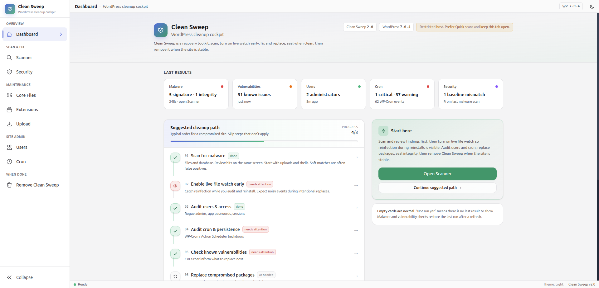

  <a href="README.md">Docs</a>
  ·
  <a href="start.md">Start</a>
  ·
  <strong>Guide</strong>
  ·
  <a href="safety.md">Safety</a>
  ·
  <a href="troubleshooting.md">Troubleshooting</a>
  ·
  <a href="develop.md">Develop</a>

# Using Clean Sweep

The **dashboard** is last results, a suggested cleanup path, and the same tools as the left sidebar.

  

Start on the dashboard, then Scanner.

## Sidebar

| Sidebar | Use it for |
| --- | --- |
| **Dashboard** | Status of last runs and where to go next |
| **Scanner** | Malware scan + vulnerability check |
| **AI scan** | Beta. Standard signature pass, then an AI review of selected files |
| **Security** | Live watch, snapshots, seal integrity |
| **Core files** | Reinstall WordPress core |
| **Extensions** | Analyze / reinstall plugins and themes |
| **Upload** | Install a clean ZIP |
| **Users** | Access audit |
| **Cron** | Scheduled-task audit |
| **Remove Clean Sweep** | Delete the toolkit when done |

Scanner results restore after a page refresh (malware via last scan, vulnerabilities for 48 hours). Users and Cron cards are from the current session until you run those tools again.

## Tools

| Area | Tool | What you get |
| --- | --- | --- |
| Scan | **Scanner** | Signature scan of files and the database, WordPress.org checksums, package verification. Profiles: Quick, Standard (default), Deep. Pause / resume on shared hosts. Review hits on the same screen. |
| Scan | **AI scan** | Beta. Runs a Standard signature pass, then sends selected PHP and JavaScript to a provider you connect. Does not delete or edit files. See [AI scan](#ai-scan). |
| Scan | **Vulnerabilities** | Separate WPVulnerability.com check for known CVEs. Use it to decide what to replace, not as a malware verdict. Last check restores after refresh. |
| Watch | **Security** | Live file watch (optional must-use agent), snapshots (pin current hashes on download, even after a manual clean), integrity seal after Clean Sweep reinstall. |
| Replace | **Core files** | Reinstall WordPress core. Keeps `wp-config.php` and `wp-content`. |
| Replace | **Extensions** | Analyze plugins/themes. Reinstall from WordPress.org or WPMU DEV (backup first). Flags likely fake / impersonating packages (stolen .org slug or decoy plugin). Already-active packages stay active. |
| Replace | **Upload** | Upload a clean ZIP to plugins, themes, uploads, or a custom path. New uploaded packages stay inactive. |
| Audit | **Users** | Hidden admins, weak hashes, application passwords, sessions. Demote, delete, revoke app passwords, destroy sessions. |
| Audit | **Cron** | WP-Cron and Action Scheduler. Delete events, clear hooks, cancel Action Scheduler jobs. |
| Done | **Remove Clean Sweep** | Deletes the toolkit folder, live-watch agent, visit data, and scan cron leftovers. |

**Recovery mode.** If WordPress is too broken to load, Clean Sweep can bootstrap a clean environment and still run. See [Troubleshooting](troubleshooting.md#recovery-mode).

## AI scan

**AI scan** is marked Beta. It sits next to Scanner and does not replace it. Scanner is still how you run Quick, Standard, or Deep with no model involved. The dashboard malware card does not treat an AI-page run as the last Scanner result.

One **Start** runs a Standard signature scan on this server, then reviews the files it is allowed to send. Database rows are signature-checked here. Their text is not sent. The scan does not delete or edit files.

1. Choose SpaceXAI, OpenAI, or OpenRouter. Paste a key, press **Load models**, pick a model, and press **Test**. Test asks for one short reply. It does not scan the site and does not send site files.
2. Optionally add folders or files under **Also skip these paths**. A skipped path is still signature-scanned. It is not sent, and that list wins even if the full pass is on.
3. Leave **Request logs** on, or turn them off. Logs are sent as method, path, status, and time, with addresses and cookies removed.
4. Leave the full pass off. Turning it on sends secret files and queued customer files to that provider. It still does not send database text. See [Safety](safety.md).
5. Press **Start** and leave this tab open. Each request does one short step. Closing the tab pauses at the last finished batch.
6. When the review finishes, read **Dangerous**, **Not decided**, and **Judged safe**. Download the PDF if you want a copy of the findings. Open a path in the same editor Scanner uses.

A signature hit the model calls ordinary code stays under **Cleared**, with **Put back on the list**. **Not sent to AI** is not a clean bill of health. Secret files stay in that group unless you turn on the full pass or press **Send this secret** for that one file after the run.

Only one malware scan runs at a time. If Scanner already has a run that is going, finish or cancel it there before **Start**.

What is sent, in short: PHP and JavaScript that failed a checksum, have no official checksum, or sit in the fixed drop-in locations, plus a window around a signature hit. Official files that match a checksum are not sent unless a signature hit is inside them. Images are not sent on this Standard pass. Password-shaped values in sent code are replaced with `[withheld]` unless the full pass is on.

## Suggested cleanup path

Typical order on a compromised site. Skip steps that do not apply. The dashboard **Suggested cleanup path** follows this list.

1. Scan for malware and review hits (uploads and shells first; soft matches are often false positives). **AI scan** is optional: it runs its own Standard signature pass, then asks your model to review the files it is allowed to send.
2. Turn on live file watch so reinfection during reinstalls is visible.
3. Audit users and access.
4. Audit cron and persistence.
5. Check known vulnerabilities if you need CVE context before replacing packages.
6. Replace compromised core, plugins, and themes (or upload a clean ZIP).
7. Download a snapshot to pin current hashes: core, plugin/theme PHP, mu-plugins, unofficial WP-root PHP, PHP sitting directly in `wp-content/`, uploads PHP (and PHP-in-image), and `.htaccess`/`.user.ini` in those trees. Cache and the media library are not sealed. Unchanged extras are not re-listed as new on compare.
8. Remove Clean Sweep when the site is stable.
